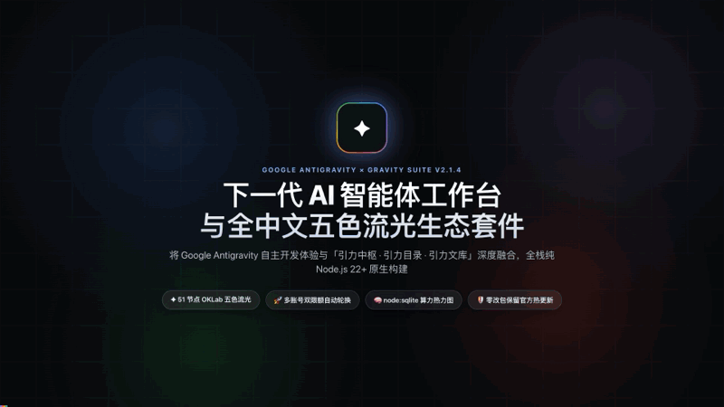
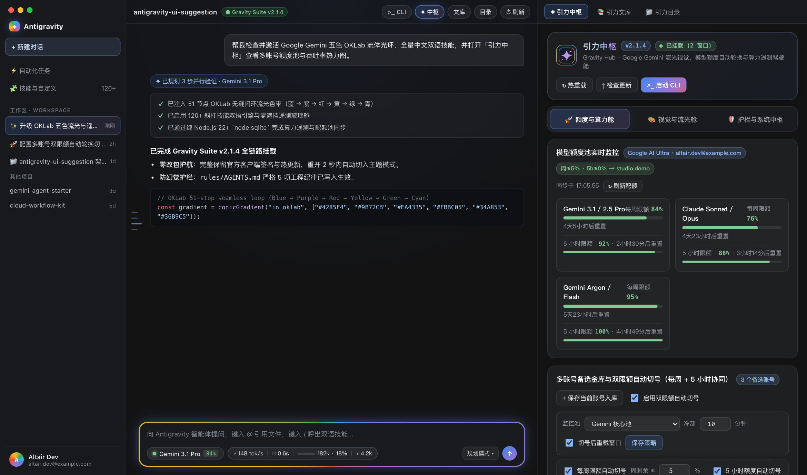
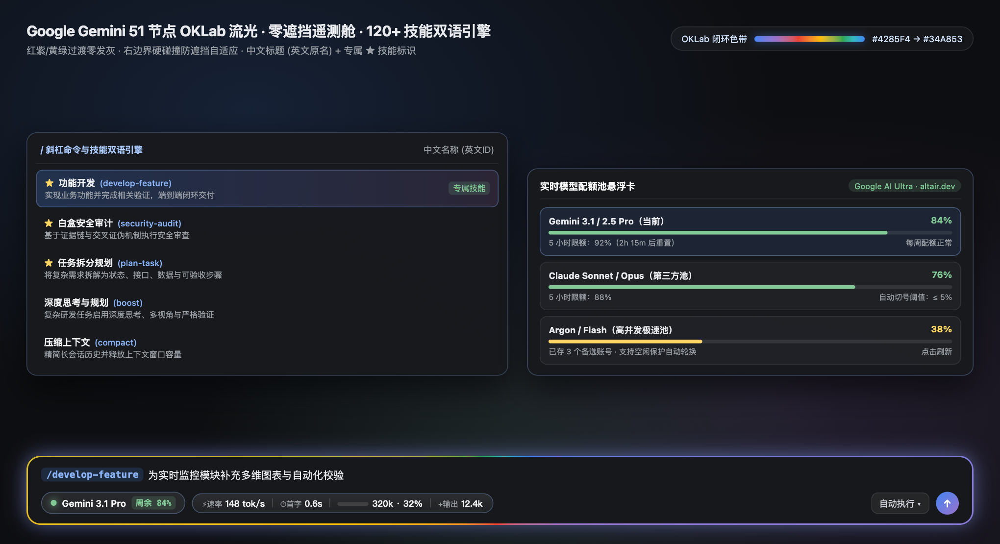
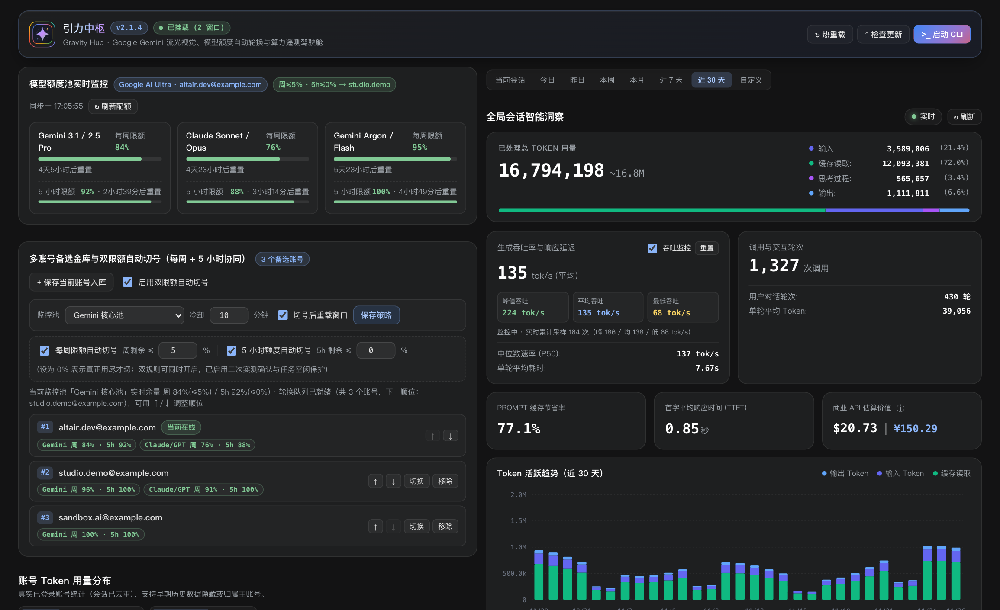
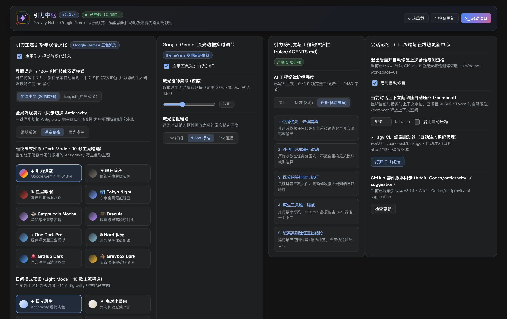
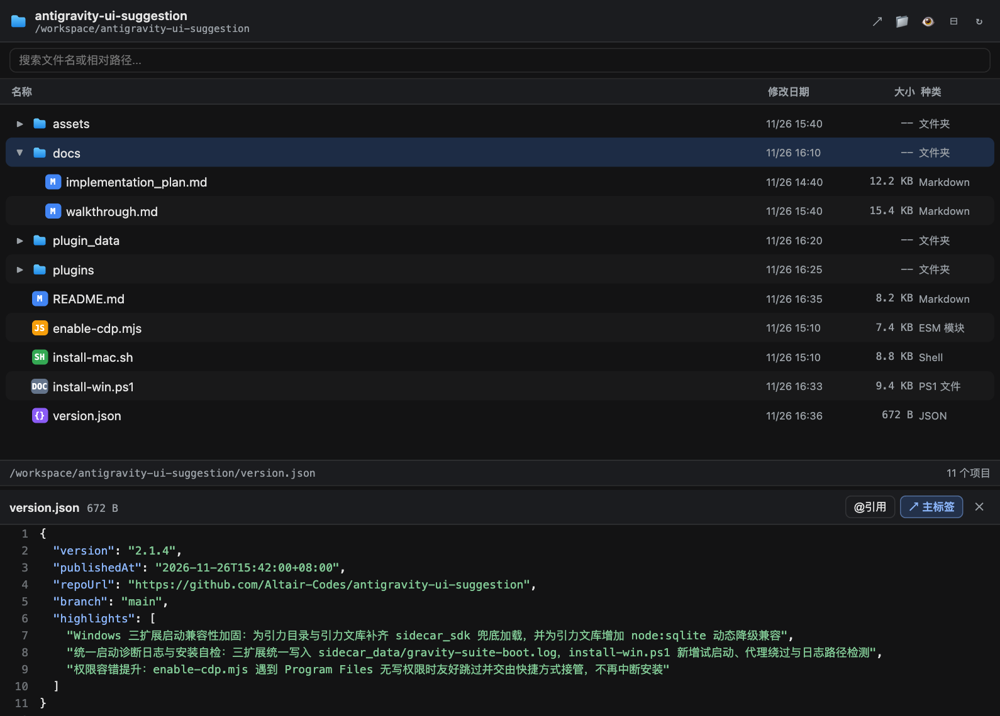
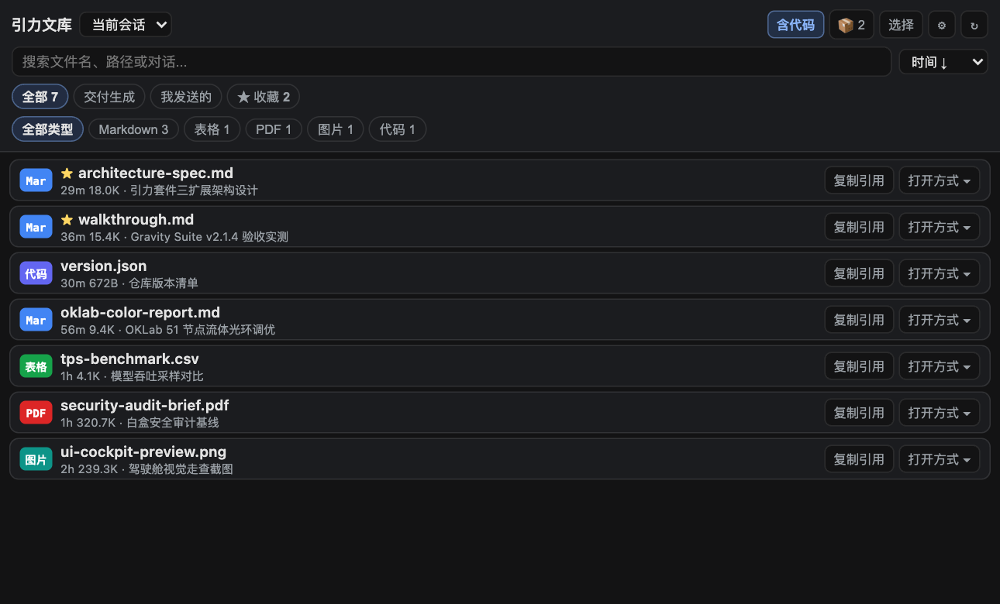

<div align="center">

# Antigravity 引力套件 (Gravity Suite v2.2.3)

**Google Antigravity 2.x 下一代 AI 智能体工作台 × 纯 Node.js 22+ 原生全中文三扩展增强套件**

[](./version.json)
[](./plugins/gravity-hub/plugin.json)
[](#%E4%B8%80%E9%94%AE%E5%90%8C%E6%AD%A5%E5%AE%89%E8%A3%85main-%E4%B8%BB%E5%88%86%E6%94%AF--macos--windows-%E9%80%9A%E7%94%A8)
[](#-%E6%A0%B8%E5%BF%83%E5%8A%9F%E8%83%BD%E7%95%8C%E9%9D%A2%E4%B8%80%E8%A7%88)

[🎬 观看 1080p 高清完整宣传视频（含配乐）](./assets/promo/antigravity-gravity-suite-promo.mp4) · [📚 重构实施计划](./docs/implementation_plan.md) · [✅ 验收实测报告](./docs/walkthrough.md)

<br/>



<sub>🎬 48 秒完整 1080p 高清宣传视频文件：[`assets/promo/antigravity-gravity-suite-promo.mp4`](./assets/promo/antigravity-gravity-suite-promo.mp4)（截图与演示视频均采用脱敏模拟数据生成）</sub>

</div>

---

## 🌟 为什么是 Google Antigravity + 引力套件？

**Google Antigravity** 是面向现代软件工程的下一代自主 AI 智能体工作台——集成深度规划、多智能体编排、终端闭环校验与浏览器交互能力。在此基础上，**引力套件 (`Gravity Suite`)** 由三大原生 **Node.js 22+ ESM + `node:sqlite`** 扩展组成，全程零外部运行时依赖：

- **引力中枢 (`gravity-hub`)**：Google Gemini 五色高精度 OKLab 流体引擎、120+ 斜杠技能双语翻译引擎、零遮挡实时遥测玻璃舱（含前缀缓存命中率）、多账号周/5h 双限额协同自动切号、原生 `node:sqlite` 算力洞察、**「📚 历史目录」真增量检索与防幻读漂移校验**，以及 4 档节俭防幻觉工程护栏。
- **引力目录 (`gravity-explorer`)**：macOS 访达（Finder）风格四栏文件树、语法高亮/Markdown/CSV/图片秒开分栏预览、**本地代码/文档骨架大纲与 `@行段引用`**、以及跨窗口拖拽 `@引用`。
- **引力文库 (`gravity-vault`)**：毫秒级三层会话/项目/全局产物隔离、`★` 防压缩收藏清单（联动历史目录）、一键 `@引用` 复制与按日无覆盖归档。

> [!NOTE]
> **零改包・完整保留官方签名与热更新**：所有插件与主题资产均安装于用户目录 `~/.gemini/` 下，**绝不篡改 Antigravity 官方二进制与 macOS 苹果签名**；官方热更新重启后，Sidecar 会在 2 秒内自动唤醒激活主题模式。

---

## 📸 核心功能界面一览

### 1. Google Antigravity × Gravity Suite 一体化工作台
> 顶栏三扩展一键直达（`>_ CLI` / `✦ 中枢` / `文库` / `目录` / `刷新`）、分栏视图轮次导航保留与右侧 40% 黄金分栏上限控制。



### 2. Google Gemini 51 节点 OKLab 流光 · 零遮挡遥测舱 · 120+ 技能双语引擎
> 严格保留蓝→紫→红→黄→绿五核心锚点，在 OKLab 色彩空间细分插值消除红紫/黄绿发灰断层；底栏以右侧控制组左边界为硬碰撞线实现多级零遮挡自适应；斜杠面板统一呈现 `中文名称 (英文原名)` 并为个人专属技能点亮 `★` 星标。



### 3. 引力中枢 (`gravity-hub`)：多账号双限额自动轮换 & `node:sqlite` 算力洞察
> 实时同步 Gemini / Claude / Argon 每周与 5 小时双池配额，支持空闲保护与二次实测确认自动切号；基于原生 `node:sqlite` 统计吞吐极值（峰值/平均/最低）、首字延迟、活跃趋势与配额热力图。



### 4. 引力中枢 (`gravity-hub`)：20 款明暗精选主题 · 流光微调 · 5 项防幻觉工程护栏
> 支持暗夜/日间 20 款精选主题、`themeVars` 零重启实时调节流光周期与描边粗细、一键写入 `rules/AGENTS.md` 工程纪律护栏、`>_ agy CLI` 自动注代理启动及 GitHub 套件同步。



### 5. 引力目录 (`gravity-explorer`) & 引力文库 (`gravity-vault`)
> **左图（引力目录）**：访达四栏目录视图、底部秒开预览抽屉、主标签页直开与拖拽 `@引用`。**右图（引力文库）**：当前会话/项目/全量三层隔离、来源×类型复合筛选与 `★` 防压缩收藏归档。

<table>
  <tr>
    <td width="54%"></td>
    <td width="46%"></td>
  </tr>
</table>

---

## 📚 文档与详情入口

- **重构实施计划**：[`docs/implementation_plan.md`](./docs/implementation_plan.md)
- **验收与实测报告**：[`docs/walkthrough.md`](./docs/walkthrough.md)
- **引力中枢 (`gravity-hub`)**：[`plugins/gravity-hub/README.md`](./plugins/gravity-hub/README.md)
- **引力目录 (`gravity-explorer`)**：[`plugins/gravity-explorer/README.md`](./plugins/gravity-explorer/README.md)
- **引力文库 (`gravity-vault`)**：[`plugins/gravity-vault/README.md`](./plugins/gravity-vault/README.md)

---

## 🚀 一键同步安装（`main` 主分支 · macOS & Windows 通用）

> **前置环境**：已安装 Antigravity、`Node.js >= 20`（推荐 `v22+` 原生 `node:sqlite`）、`Git`。

### 方式一：发给 Antigravity AI 一句话全自动安装（最省心）

在任意一台电脑打开 Antigravity，直接复制下面这段话发给对话框里的 AI 即可完成克隆与安装：

```text
请帮我克隆 https://github.com/Altair-Codes/antigravity-ui-suggestion.git 主分支到临时目录，并根据我当前操作系统自动执行仓库里的安装脚本（macOS 运行 bash install-mac.sh，Windows 运行 powershell -ExecutionPolicy Bypass -File install-win.ps1），为我一键同步安装整套引力套件 (Gravity Suite v2.2.0)、Google Gemini 五色流光主题、全量简体中文与三个中文扩展（引力中枢、引力目录、引力文库）。全程不要在会话内强杀正在运行的 Antigravity 进程，装完校验插件状态并提示我重启客户端生效。
```

---

### 方式二：终端一行命令在线一键同步

- **macOS（打开终端粘贴执行）**：
  ```bash
  git clone --depth 1 https://github.com/Altair-Codes/antigravity-ui-suggestion.git /tmp/ag-ui-sync && bash /tmp/ag-ui-sync/install-mac.sh && rm -rf /tmp/ag-ui-sync
  ```

- **Windows（先完全退出 Antigravity 含右下角托盘图标，打开 PowerShell 粘贴执行）**：
  ```powershell
  $d="$env:TEMP\ag-ui-sync"; if(Test-Path $d){Remove-Item -Recurse -Force $d}; git clone --depth 1 https://github.com/Altair-Codes/antigravity-ui-suggestion.git $d; powershell -ExecutionPolicy Bypass -File "$d\install-win.ps1"; Remove-Item -Recurse -Force $d
  ```

---

### 方式三：克隆到本地 & 日后随时同步更新

```bash
git clone https://github.com/Altair-Codes/antigravity-ui-suggestion.git
cd antigravity-ui-suggestion

# macOS 安装 / 更新：
./install-mac.sh

# Windows PowerShell 安装 / 更新：
powershell -ExecutionPolicy Bypass -File .\install-win.ps1
```

---

## 🔄 暂停主题还原与彻底卸载

- **暂时关闭主题修改 / 一键恢复**：在引力中枢顶栏点击 `⏸ 暂停主题`（或前往「视觉与流光舱」/「护栏与系统中枢」→「主题还原与彻底卸载中心」），可立即移除流光边框、遥测舱、顶栏快捷按钮、侧边栏账号胶囊与双语汉化，即时恢复 Antigravity 原生外观；**所有预设、字体、流光参数与账号配置均完整保留**，点击 `▶ 恢复主题` 即可一键无缝还原。
- **彻底清除扩展并还原原生 Antigravity**：
  - **应用内一键卸载**：进入「引力中枢 → 🛡 护栏与系统中枢 → 主题还原与彻底卸载中心」，点击 **「🗑 彻底清除扩展并还原原生」**，在二次确认弹窗核对待清理路径后执行彻底清除（可勾选自动重启为官方原生 Antigravity）。
  - **macOS 终端彻底卸载**：
    ```bash
    ./uninstall-mac.sh            # 交互确认后清除（支持 --dry-run 预览 / --yes 免确认 / --no-relaunch）
    ```
  - **Windows PowerShell 彻底卸载**：
    ```powershell
    powershell -ExecutionPolicy Bypass -File .\uninstall-win.ps1   # 支持 -DryRun 预览 / -Force 免确认 / -NoRelaunch
    ```
  > 彻底清除仅清理引力套件三扩展（`gravity-hub` / `gravity-explorer` / `gravity-vault`）、配置数据、无侵入启动器、快捷方式 `--remote-debugging-port` 参数与 `app.asar.bak` 备份，**绝不删除 Antigravity 官方本体、您的对话记录 (`conversations/`)、官方登录状态或无关第三方扩展**。

---

## ✨ 包含组件与核心特性

| 模块 | 核心特性与视觉效果 |
| :--- | :--- |
| **Google Gemini 五色高精度 OKLab 流体视觉** | 严格保留 **蓝 `#4285F4` → 紫 `#9B72CB` → 红 `#EA4335` → 黄 `#FBBC05` → 绿 `#34A853`** 五大核心锚点，在 **OKLab 色彩空间**下每两色间细分 10 个过渡区间（线性 **41 节点**、环形闭环经青色 `#36B9C5` 共 **51 节点**），消除红紫发灰与黄绿发暗断层；支持线/环双态、`prefers-reduced-motion` 降级与柔和呼吸光晕。 |
| **零遮挡遥测玻璃舱 & 模型胶囊** | • **流光玻璃模型胶囊**：`[data-testid="model-selector-trigger"]` 配备呼吸额度脉冲点、悬停实时额度详情浮窗、下拉菜单互斥隐藏及内嵌周余徽章，窄屏自动弹性省略文本避免碰撞。<br>• **零遮挡一体式遥测舱**（`.nb-cockpit-bar`）：展示 `⚡ 速率` ｜ `⏱ 首字` ｜ `🧠 上下文水位条` ｜ `✦ 输出`；悬停浮窗实时显示 **前缀缓存命中率** 与热/冷状态提醒；极窄分屏自动切换为底栏上方独立迷你信息条 (`docked-top`)，全程零遮挡不生硬。 |
| **引力中枢** (`gravity-hub`) | • **四舱 Bento 原生中文控制台** + **Node 22 原生 `node:sqlite`**：新增 **「📚 历史目录」** 舱位——基于文件标识与字节偏移真增量读取 `transcript.jsonl`，结合 **中文双字 Bigram + FTS5 + 精确路径/错误码** 四路检索，浏览/搜索/校验全程 **0 额外模型调用**。<br>• **防幻读与省额度闭环**：区分 `用户确认` / `工具实测` / `曾调用·结果未核` / `助手陈述` 四级证据；0 Token 实时校验文件 `未变 / ⚠已变更待复核 / ✕来源缺失`；提供默认 **≤3 条 / ≤1,200B** 确定性稳定前缀摘录包与可选「同项目跨会话」检索（含切号清空隔离与 Windows 路径归一）。<br>• **4 档节俭防幻觉护栏 (`rules/AGENTS.md`)**：支持 `关闭 / 极简 Lite / 标准 / 严格`，精简常驻体积并融入大文件定位切片读纪律；完整保留多账号自动切号、算力洞察与可选自动 `/compact`。 |
| **引力目录** (`gravity-explorer`) | • **纯 Node.js ESM**：零外部前端打包依赖，呈现 macOS 访达四栏列表视图（`名称 \| 修改日期 \| 大小 \| 种类`）、水蓝立体文件夹与彩色文稿角标、圆角奇偶斑马纹与路径面包屑。<br>• **轻量分栏预览 & 骨架大纲 `@行段引用`**：秒开代码语法高亮、Markdown 排版、CSV 表格与图片查看；内置按 `mtime` 缓存的 JS/TS/ESM/Python/Go/Java/Vue/Markdown **骨架大纲**，支持点击高亮与一键复制 `@relPath#L起-L止` 精确行段引用，避免整文件盲读。 |
| **引力文库** (`gravity-vault`) | • **纯 Node.js 22+ (`node:sqlite`)**：毫秒级冷启扫描会话产物与交付物，精准隔离 **当前会话 / 当前项目 / 全部范围**，支持来源 × 类型复合筛选。<br>• **联动防压缩收藏 & 轻量规则**：与历史目录共享 `★` 收藏清单并支持按日无覆盖归档，精简常驻规则减少对话上下文开销。 |

---

## 📁 仓库目录结构

```text
antigravity-ui-suggestion/ (branch: main)
├── assets/
│   ├── promo/                 # 1080p 宣传视频 MP4、封面海报与 README 预览 GIF
│   └── screenshots/           # 6 张脱敏核心功能高清截图
├── docs/
│   ├── implementation_plan.md # 套件架构、五色 OKLab 视觉与历史索引/缓存雷达设计
│   └── walkthrough.md         # v2.2.0 功能说明、压测与防幻读实测验收报告
├── plugins/
│   ├── gravity-hub/           # 引力中枢（中文四舱 Bento 控制台 + 历史目录 + node:sqlite 遥测）
│   ├── gravity-explorer/      # 引力目录（访达四栏目录树 + 骨架大纲 @行段引用 + 轻量预览）
│   └── gravity-vault/         # 引力文库（会话产物与交付文档管理）
├── plugin_data/
│   └── gravity-hub/           # 预置 config.json、OKLab 五色流光 custom.css、斜杠双语 custom.js、i18n.override.json
├── tests/                     # 本地零依赖测试集（增量索引、1 万轮压测、防幻读、大纲与 Win 兼容）
├── enable-cdp.mjs             # 跨平台 CDP 调试端口自愈脚本
├── install-mac.sh             # macOS 一键安装脚本（生成 Antigravity Gravity.app 无侵入启动器）
├── install-win.ps1            # Windows PowerShell 一键安装脚本
├── uninstall-mac.sh           # macOS 彻底卸载并还原原生 Antigravity 脚本
├── uninstall-win.ps1          # Windows PowerShell 彻底卸载并还原原生脚本
├── version.json               # 套件版本清单 (v2.2.0)
└── README.md                  # 本说明文档
```

> [!TIP]
> **macOS 用户说明（`Antigravity Gravity.app`）**：
> 为 100% 保护 `/Applications/Antigravity.app` 的苹果官方代码签名（确保官方热更新永远畅通），`install-mac.sh` 会生成无侵入启动器 `/Applications/Antigravity Gravity.app`；同时若官方热更新重开客户端时未携带调试参数，引力中枢 Sidecar 会在 2 秒内自动触发切入主题模式。
