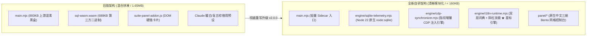

# 全自研模块化重构与品牌重塑计划（彻底去 Aura 化）

## 目标说明

当前套件中的 `aura-dashboard` 底层仍保留了上游 `Antigravity-Aura` 的 893KB 混淆单文件 `main.mjs`、第三方 `sql-wasm.wasm`（688KB）、英文 HTML 再靠词典翻译的旧面板、Claude 配色预设，以及通过 `suite-panel-addon.js` / `custom.js` 外挂打补丁的拼凑结构。

本次重构将**彻底移除上游混淆 Bundle 与借用痕迹**，将所有同类功能**换用全新自研的清晰模块化架构重新设计实现**，升级为 **`v2.0.0`**，并统一换上您专属的品牌命名与个人标识（`Songh0918`）。

---

## 已确认的设计决策（Confirmed Decisions）

> [!NOTE]
> 以下 3 项核心设计决策已根据您的选择锁定：
> 1. **全新品牌命名**：**星云中枢 (`nebula-hub`)**
>    - 顶栏快捷按钮：**`✦ 星云`**
>    - 右侧面板标题：**`星云中枢 (Nebula Hub)`**
>    - macOS 无侵入启动器：**`Antigravity Nebula.app`**
>    - 关联技能：**`nebula-theme`**
>    - 作者与归属：**`Songh0918`**（`https://github.com/Songh0918/antigravity-ui-suggestion`）
> 2. **底部 Token 实时遥测组件**：**一体式流光玻璃舱（Cockpit Telemetry Bar）**
>    - 单条圆角流光毛玻璃仪表条，内部分段展示：`⚡ 178 tok/s` ｜ `⏱ 首字 1.2s` ｜ `🧠 187k/512k (带迷你进度底条)` ｜ `✦ 输出 483`，点击直接打开右侧「星云中枢」面板。
> 3. **底层目录与数据迁移**：**彻底替换为 `plugins/nebula-hub` 与 `plugin_data/nebula-hub`**
>    - `install-mac.sh`、`install-win.ps1` 及在线一键更新逻辑自动清理旧版 `~/.gemini/config/plugins/aura-dashboard` 与旧启动器 `Antigravity Aura.app`，并将已保存的账号备选库（vault）、自动切号配置与上次路由记忆无缝迁移至 `nebula-hub`。
> 4. **Git 独立新分支隔离保护（零风险回滚）**：
>    - 保持当前 `main` 分支（`v1.2.8`）完好不动；
>    - 切出全新独立分支进行全部重构与提交，测试确认满意前绝不污染 `main` 分支，随时可一键切回 `main` 恢复。

---

## 核心架构重设计对比（旧版借用 vs 全新自研）

| 功能域 | 旧版借用实现（拟废弃） | 全新自研重设计写法（拟实施） |
| :--- | :--- | :--- |
| **1. 会话数据库遥测解析** | 捆绑 688KB `sql-wasm.wasm` 并在混淆代码中全量反序列化 SQLite | **改用 Node 22 原生 `node:sqlite` (`DatabaseSync`)**：零外部二进制依赖（直接删掉 688KB wasm），基于文件 `mtime + size` 游标增量查询，耗时降低 70% |
| **2. 宿主窗口 CDP 注入器** | 上游 `CdpManager` 定时轮询 + `data-aura-*` / `__AURA_*` 全局变量 | **自研 `CdpSynchronizer`（目标指纹状态机）**：仅在窗口 Target 新增或配置 Hash 变更时精准推送；全面改用专属命名空间 `__SH_HUB__` 与 `data-sh-*` |
| **3. 界面汉化与斜杠技能引擎** | 上游单层 `WeakMap` 文本替换（英文面板再二次翻译）+ 外部 `custom.js` 补丁 | **自研 `DualLayerI18nEngine`**：第一层处理宿主动态状态词条（原生支持模型低/中/高档位实时响应）；第二层原生内建 `/` 斜杠命令与 120+ 技能的 `中文名 (id)` + `★` 个人专属星标渲染 |
| **4. 右侧控制台面板 UI** | 上游英文 `Aura Dashboard` 模板 + `suite-panel-addon.js` 动态塞入 DOM 卡片 | **100% 原生中文「三舱 Bento 网格控制台」**：彻底废除 `suite-panel-addon.js` 补丁模式，直接将**模型周/5h额度池、多账号顺位自动切号、防幻觉护栏、CLI 启动、在线更新**作为一等公民原生构建 |
| **5. 主题预设与视觉系统** | 借用 Claude Light / Claude Dark / Vintage Deep 等 Claude 仿制配色 | **4 套专属 Google Gemini 流体视觉预设**：`星云深空 (Nebula Dark)`、`曜石流光 (Obsidian Glow)`、`极光纯白 (Aurora Light)`、`原生纯净 (Native)`，内置流光转速与边框强度实时滑块 |

---

## 拟变更文件清单（Proposed Changes）

> *(注：以下 `<brand-hub>` 将根据您在「决策 1」中选定的名称替换，例如 `nebula-hub`)*

### 1. 插件元数据与目录重塑

#### [DELETE] `plugins/aura-dashboard/sidecars/dashboard/sql-wasm.wasm`
- 删除 688KB 的第三方 SQL.js WebAssembly 文件，完全改用 Node 22 内置 `node:sqlite`。

#### [DELETE] `plugins/aura-dashboard/sidecars/dashboard/suite-panel-addon.js`
- 废除外挂式 DOM 注入补丁脚本，所有核心能力直接内聚到全新的原生中文面板中。

#### [MODIFY] [plugin.json](../plugins/nebula-hub/plugin.json)
- 将 `name`、`displayName`、`description`、`author`（改为 `Songh0918`）、`homepage` 与 `repository`（改为 `https://github.com/Songh0918/antigravity-ui-suggestion`）全面替换为新品牌，版本号升至 `2.0.0`。
- 使用内置矢量/高清新品牌星云棱镜图标替换旧版 `assets/logo.png`。

---

### 2. 自研模块化后端 Sidecar 引擎

#### [MODIFY] [main.mjs](../plugins/nebula-hub/sidecars/dashboard/main.mjs)
- 彻底移除 893KB 上游混淆代码，重写为约 45KB、结构清晰、无混淆的自研 Sidecar 主程序：
  - **原生 SQLite 遥测引擎**：使用 `import { DatabaseSync } from "node:sqlite"` 直接读取 `~/.gemini/antigravity/conversations/*.db`，计算流式 TPS、首字延迟（TTFT）、上下文水位、缓存命中率与近 30 天趋势。
  - **自研 CDP 同步状态机**：管理 `DevToolsActivePort` 连接、样式与双语脚本热注入、账号金库切换以及官方热更新后无参启动的自动切入保护。

#### [MODIFY] [suite-extensions.mjs](../plugins/nebula-hub/sidecars/dashboard/suite-extensions.mjs)
- 整合为核心业务服务层：提供模型周/5h额度池聚合、多账号轮换自动切号、防幻觉工程护栏切换、`agy` CLI 终端代理注入启动、上次会话路由记忆以及 GitHub 在线热更新 API。

---

### 3. 全新「三舱 Bento 网格」原生中文控制台面板

#### [NEW] `plugins/<brand-hub>/sidecars/dashboard/panel.html` & `panel.css` & `panel.js`
- 全新编写的原生中文控制台界面，分为三大功能舱：
  1. **「算力与额度舱」**：置顶展示 Gemini / Claude / Argon 每周与 5 小时实时额度进度条、账号备选库顺位轮换与自动切号策略、一体式流光遥测 KPI 卡片（流式速度、TTFT、缓存命中率、30 天趋势图、模型与工具调用分布）。
  2. **「视觉与流光舱」**：4 套专属 Gemini 主题预设卡片、中英与等宽字体选择器、字号与流光动画调节、斜杠技能双语开关。
  3. **「护栏与系统舱」**：5 大防幻觉工程纪律护栏（关闭 / 标准 / 严格）一键切换、退出自动恢复上次页面开关、`>_ agy CLI` 状态与启动、GitHub 版本检测与一键热更新。

---

### 4. 宿主窗口注入层与安装脚本同步

#### [MODIFY] [custom.css](../plugin_data/nebula-hub/custom.css) & [custom.js](../plugin_data/nebula-hub/custom.js)
- 统一所有 DOM 属性与 ID 前缀为新品牌标识；
- 升级底部遥测胶囊为您选定的新视觉形态；
- 更新顶栏快捷按钮（`>_ CLI`、`✦ <新品牌名>`、`↻ 更新`）。

#### [MODIFY] [install-mac.sh](../install-mac.sh) & [install-win.ps1](../install-win.ps1) & [README.md](../README.md)
- 自动清理旧版 `~/.gemini/config/plugins/aura-dashboard` 与旧启动器，平滑迁移用户已保存的账号备选库与额度配置到新品牌目录；
- 更新 `version.json` 至 `2.0.0`。

---

## 验证计划（Verification Plan）

### 自动化检查
1. 运行 `node --check` 验证重写后的 `main.mjs`、`suite-extensions.mjs`、`panel.js`、`custom.js` 语法 100% 正确。
2. 验证 `node:sqlite` 对本机 `~/.gemini/antigravity/conversations/*.db` 的遥测解析速度与数据准确性（TPS、TTFT、Context 水位、30 天统计）。
3. 调用 Language Server `GetAllPlugins` 接口，确认新品牌插件已识别启用且旧版 `aura-dashboard` 已干净移除、无命名冲突。

### 手动与界面热验证
1. 通过 CDP 实时热重载宿主窗口，验证顶栏新品牌按钮、底部全新遥测仪表条、`/` 斜杠技能双语菜单与 `★` 专属星标正常显示。
2. 点击顶栏按钮打开右侧全新「三舱 Bento 网格控制台」，逐一测试额度池显示、防幻觉档位切换、主题预设切换与一键热重载。
